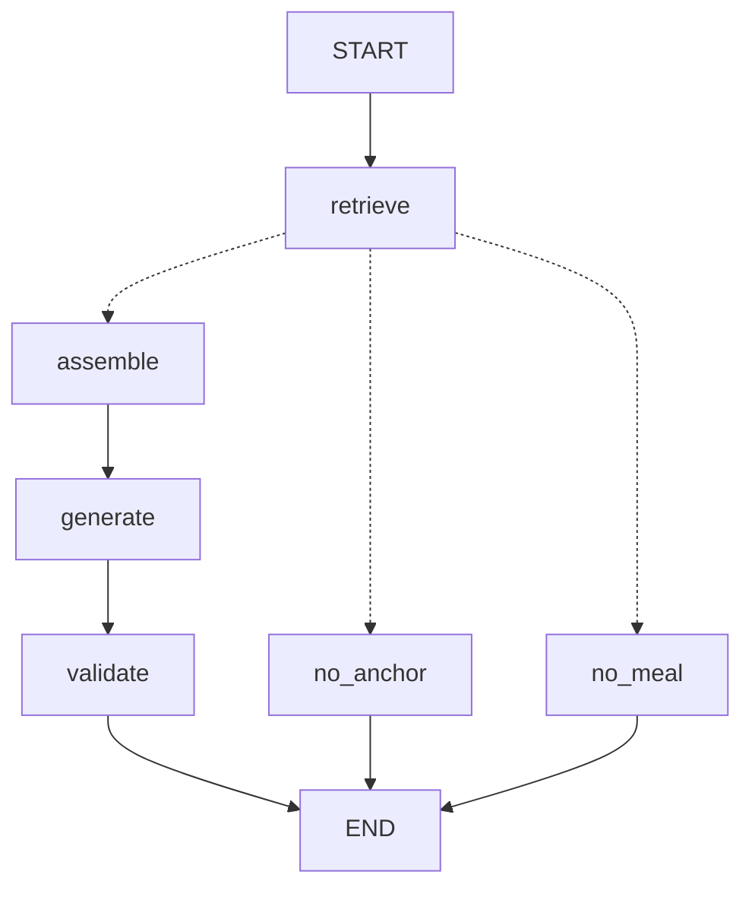

# RAG 여행 코스 다음 단계 가이드 (MariaDB → ChromaDB 적재 · OpenAI · LangChain · LangGraph)

작성일: 2026-11-11 · 개정 4: 2026-11-11 (벡터 DB는 ChromaDB, MariaDB 데이터를 ChromaDB로 넣는 작업 추가. 임베딩·질의 응답은 OpenAI API, 구현은 LangChain + LangGraph 유지)
이전 문서: [TourAPI_RAG_여행코스_작업가이드.md](/mnt/project-files/analysis/TourAPI_RAG_여행코스_작업가이드.md) (KorService2 단독 1차 버전, Phase 0~6)
근거: 사용자 PC의 `smart-traveler\ai-server` 코드와 `chroma_data`, `smarttraveler`의 `application.properties`·`tour_schema.sql`, Git에 저장된 `TourSyncService.java`·`PlaceIndexClient.java`·`RestaurantDetail.java`, 루트의 `TourAPI_RAG_사용가이드.md` (10:43 기준, ai-server 코드는 00:30 확인 때와 같음). `.env`와 비밀번호 값은 열지 않았습니다.

> 새 코드는 [RAG_Phase3-4_코드](/mnt/project-files/analysis/RAG_Phase3-4_코드/) 폴더에도 파일로 있습니다. 클라우드에 MariaDB 10.11을 띄워 해운대구 장소 281곳을 넣고 **MariaDB → ChromaDB 적재**를 돌려 봤고, 실제 `chroma_data`로 LangGraph 코스 그래프까지 실행했습니다. `pytest`는 35개 모두 통과했습니다(7장). 실제 OpenAI 호출은 키가 없어 하지 않았습니다.

---

## 0. 한눈에 보기

### 0-1. 조건과 구조

| 조건 | 이 가이드에서 |
| --- | --- |
| 원본 데이터 = MariaDB | 장소는 Spring이 KorService2에서 받아 `place`, `restaurant_detail`, `place_image`, `place_hub_rank`에 저장 (지금 그대로) |
| 벡터 DB = ChromaDB | `ai-server/chroma_data`의 `places` 컬렉션. 검색은 Chroma에서 |
| MariaDB → ChromaDB 적재 | **새로 추가**: ai-server가 MariaDB를 직접 읽어 Chroma에 넣는 `sync_from_mariadb()` + API + 명령줄 스크립트 |
| AI 임베딩 = OpenAI API | `text-embedding-3-small`을 LangChain `OpenAIEmbeddings`로 호출 (장소 문서, 검색 질의) |
| 질의 응답 = OpenAI API | `gpt-4o-mini`를 LangChain `ChatOpenAI`로 호출. 검색된 장소 문서를 근거로 코스 제목·요약·소개 생성 |
| LangChain | 위 두 호출, `SystemMessage`/`HumanMessage`, `with_structured_output(strict JSON)` |
| LangGraph | 코스 추천 흐름을 `StateGraph`로: **검색 → 조합 → 응답 생성 → 검증** |

```
[적재] MariaDB → ChromaDB
  ① 지금 있는 경로: Spring 관리자 동기화 → POST /internal/places/index (Spring이 MariaDB에서 읽어 보냄)
  ② 새로 추가:      ai-server POST /internal/places/sync {"sigunguCode":"26350"}
                    또는  python -m scripts.sync_mariadb_to_chroma 26350
       MariaDB (place + region + restaurant_detail + place_image + place_hub_rank)  ── pymysql로 읽기만
         └▶ 장소 문서 만들기 (to_document)
              └▶ 문서가 새로 생기거나 바뀐 장소만 OpenAI 임베딩 (LangChain OpenAIEmbeddings)
                   └▶ ChromaDB upsert  /  MariaDB에서 비활성·이름만 있는 장소는 Chroma에서 삭제

[질문] Spring ─▶ POST /internal/courses/recommend ─▶ LangGraph 코스 그래프
   START
     └▶ retrieve   질의 임베딩(OpenAI) + ChromaDB 검색(메타데이터 필터 + 코사인 유사도) → 앵커 + 슬롯별 Top-5
          ├─(앵커 없음)▶ no_anchor ─▶ END (422)
          ├─(식당 없음)▶ no_meal   ─▶ END (422)
          └▶ assemble  슬롯마다 점수 1등, 순서(템플릿), 시간 계산, 초안 문장   ← 코드, OpenAI 안 씀
               └▶ generate  검색된 장소 문서를 근거로 OpenAI(ChatOpenAI)가 제목·요약·소개 생성
                    └▶ validate  장소가 바뀌었으면 생성 문장을 버리고 초안 사용 → 응답 JSON
                         └▶ END ─▶ Spring(CourseDraft) ─▶ 프론트
```

**어떤 장소를 넣을지는 Chroma 검색 점수와 코드가 정하고, OpenAI는 그 결과를 문장으로 만듭니다.** OpenAI가 실패하거나 엉뚱한 장소를 말해도 코스는 같게 나오고 문장만 초안으로 바뀝니다(`polished: false`).

### 0-2. 왜 적재 경로를 하나 더 두나

Spring 동기화(①)는 이미 MariaDB에서 장소를 읽어 ai-server로 보내고 있습니다(`TourSyncService.indexPlaces()` → `PlaceIndexClient`). 하지만 이 경로는 **TourAPI 동기화를 돌릴 때만** 실행되고, TourAPI 호출 한도(하루 1,000건 수준)를 씁니다. 그래서 아래 경우에 막힙니다.

| 상황 | ① Spring 동기화만 있을 때 | ② MariaDB → Chroma 적재가 있으면 |
| --- | --- | --- |
| `chroma_data`를 지웠거나 새 팀원 PC | TourAPI를 다시 다 불러야 함 | MariaDB에서 바로 다시 채움 (TourAPI 호출 0) |
| 관리자가 DB에서 장소를 비활성화 | 다음 동기화 전까지 Chroma에 남음 | 적재 한 번이면 Chroma에서 빠짐 |
| 임베딩 실패(`AI_SERVER/INDEX` FAILED) | 동기화를 다시 돌려야 함 | 적재만 다시 |
| 문서가 안 바뀐 장소 | 동기화 때마다 전부 다시 임베딩 | **바뀐 것만** 임베딩 (OpenAI 비용 절약) |

두 경로는 같은 `index_places()`를 쓰고 같은 문서·메타데이터를 만들기 때문에 섞어 써도 결과가 같습니다.

### 0-3. 현재 코드와 비교

| 항목 | 지금 PC 코드 | 이 가이드 적용 후 | 바꾸는 파일 |
| --- | --- | --- | --- |
| 벡터 DB | ChromaDB (`./chroma_data`, **상대경로**) | ChromaDB 그대로, 경로만 `ai-server/chroma_data`로 고정 | `app/rag.py` |
| MariaDB → Chroma | Spring 동기화 때만 (①). ai-server는 MariaDB에 연결하지 않음 | ② 추가: ai-server가 MariaDB를 직접 읽어 적재, 바뀐 것만 임베딩, 비활성 삭제 | `app/db.py` 새로, `app/rag.py`, `scripts/sync_mariadb_to_chroma.py` 새로 |
| 이름만 있는 장소 | 그대로 임베딩 (Chroma 281곳 중 73곳) | 넣지 않음, 적재 때 Chroma에서 삭제 | `app/rag.py` (`is_indexable`) |
| AI 임베딩 (OpenAI) | **사용 중.** `OpenAIEmbeddings` | 그대로 | |
| 질의(검색) | **없음.** 파이썬으로 Chroma 직접 조회(`TourAPI_RAG_사용가이드.md` 3장) | 질의 임베딩 + Chroma 메타데이터 필터(지역·타입·시장·위경도) + 정확한 거리·점수 | `app/search.py` 새로 |
| 질의 응답 (OpenAI) | 채팅에서 `ChatOpenAI`가 이름순 후보 30개 중 3곳 ID 선택(RAG 아님) | 검색된 장소 문서를 근거로 코스 제목·요약·소개 생성. 장소는 코드가 고름 | `app/compose.py` 새로 |
| LangChain | **사용 중** (`ChatOpenAI`, `OpenAIEmbeddings`) | 그대로 + 코스 문장 생성 | |
| LangGraph | **대화에만 사용** (`build_graph()`) | **코스 그래프 `build_course_graph()` 추가** | `app/course_graph.py` 새로 |
| ai-server API | `/internal/dialogue`, `/internal/tour/*`, `/internal/places/index`, `/remove` | + `/internal/places/sync`, `/internal/places/search`(확인용), **`/internal/courses/recommend`** | `app/main.py` |
| Spring 추천 API | `/api/courses/recommendations`는 503 | recommend 결과를 `CourseDraft`로 | 8장 |
| 테스트 | 25개 | 35개 (OpenAI·MariaDB 없이 돌아감) | `tests/test_search.py` 새로 |

### 0-4. 진행상황 요약과 실행 결과

- **Phase 1(수집)과 Phase 2(임베딩)는 끝났습니다.** Chroma에 해운대구(26350) 장소 281곳이 있고, 1차 가이드의 Phase 1 완료 기준을 모두 넘습니다.
- **그중 73곳은 이름만 있는 행입니다**(place_id 499~571, 주소·소개 없음, 호텔·백화점 포함). 적재를 한 번 돌리면 Chroma에서 빠집니다.
- **이번에 할 일**: MariaDB → Chroma 적재(2장) → Phase 3 검색(4장) → Phase 4 LangGraph 코스 그래프(5장).

클라우드 MariaDB(해운대구 281곳)로 적재를 돌린 결과입니다(임베딩은 가짜 함수).

| 실행 | 결과 |
| --- | --- |
| 1회차 (빈 Chroma) | 읽음 281, 이름만 있어 건너뜀 73, **임베딩 208**, 삭제 0 (0.26초) |
| 2회차 (바뀐 것 없음) | 임베딩 **0**, 그대로 208 |
| `해운대시장`을 MariaDB에서 비활성화 후 | 삭제 1 |
| 다시 활성화 후 | 임베딩 1 |

PC의 기존 `chroma_data`에 처음 돌리면, Spring이 만든 문서와 같은 문서를 만들기 때문에 208곳은 "그대로"로 처리되어 다시 임베딩하지 않고, 이름만 있는 73곳은 삭제될 것으로 예상합니다(PC에서는 실행하지 않았습니다).

실제 `chroma_data`(이름만 있는 행 제외)로 코스 그래프를 돌린 결과입니다(키가 없어 질의 벡터 대신 장소 벡터를 썼고, 응답 생성은 실패 처리되어 초안 문장 사용).

| 순서 | 슬롯 | 장소 | 시간 |
| --- | --- | --- | --- |
| 1 | ANCHOR | 해운대해수욕장 | 10:00~11:30 |
| 2 | MEAL | 할매집 | 11:35~12:35 |
| 3 | FUN | 씨라이프부산아쿠아리움 | 12:40~14:10 |
| 4 | MARKET | 해운대시장 | 14:15~15:15 |

---

## 1. 현재 진행상황 상세

### 1-1. ai-server

| 파일 | 지금 상태 |
| --- | --- |
| `requirements.txt` | `langchain`, `langchain-openai`, `langgraph`, `chromadb==1.5.9`, `python-dotenv` |
| `app/rag.py` | `OpenAIEmbeddings("text-embedding-3-small")`, Chroma `PersistentClient(path="./chroma_data")` (실행 위치에 따라 다른 폴더를 씀), `index_places`, `remove_places` |
| `app/graph.py` | LangGraph `StateGraph(DialogueState)`: extract(ChatOpenAI) → merge → ask/complete/recommend/clarify |
| `app/main.py` | `.env`를 절대경로로 읽음, `/internal/places/index`, `/remove` |
| `app/tour_api.py` | `contentTypeId="12"`만 (새 기능에는 안 씀) |

### 1-2. Spring 쪽 적재 경로 (Git에 저장된 코드 기준)

- `TourSyncService.sync(regionCode)`: 12·14·28·38·39 수집 → 중심관광지 순위 → 연관 관광지 → **`indexPlaces()`**.
- `placesForIndexing()`: `place JOIN region LEFT JOIN restaurant_detail` + 대표 이미지 + 최소 `hub_rank`, 조건 `is_active=TRUE AND 좌표 있음`. 이걸 `PlaceIndexClient`가 100개씩 `/internal/places/index`로 보냅니다.
- `place.is_market` 칸이 있습니다(`isMarket()`: 신분류 SH06=시장 또는 이름에 "시장"). `tour_schema.sql`에는 이 칸이 아직 없으니 팀원 PC 스키마와 맞는지 확인하세요(JPA `ddl-auto=update`가 만들었을 수 있음).
- 중심관광지 전용 장소는 TourAPI 장소와 이름이 맞으면 비활성화합니다. 이름이 안 맞은 73곳이 활성으로 남아 Chroma에 들어간 것으로 보입니다.

ai-server의 새 적재 코드는 **이 SQL을 그대로 옮겨** 같은 행을 읽습니다.

### 1-3. Chroma 데이터

| 항목 | 값 |
| --- | --- |
| 전체 | 281곳 (모두 26350) |
| 타입 | ATTRACTION 114, RESTAURANT 87, SHOPPING 50, CULTURE 18, LEISURE 12 |
| 시장 | 3 (좌동재래시장, 해운대시장, 반송3동골목시장) |
| 소개글 있음 | 208 (74%) |
| 이름만 있는 행 | 73 |

테스트: 깨끗한 환경에서 기존 25개 통과. PC의 마지막 실행 기록에는 `test_tour_api.py`가 실패로 남아 있고 Python 3.14 캐시가 있어, venv가 아닌 파이썬으로 돌린 것으로 보입니다(추정). `.\.venv\Scripts\python.exe -m pytest -q`로 다시 확인하세요.

---

## 2. MariaDB → ChromaDB 적재

### 2-1. 준비: `.env`와 패키지

ai-server가 MariaDB를 **읽기만** 합니다. Spring `application.properties`와 같은 DB(`jdbc:mariadb://localhost:3306/smart_travel_db`)와 계정을 씁니다. 기존 `OPENAI_API_KEY` 아래에 추가하세요. 비밀번호는 Git에 올리지 않습니다(`.env`는 이미 커밋되지 않는 파일). 가능하면 SELECT 권한만 있는 계정을 따로 만들어 쓰는 것이 더 안전합니다.

```
DB_HOST=127.0.0.1
DB_PORT=3306
DB_NAME=smart_travel_db
DB_USERNAME=(Spring과 같은 계정 또는 읽기 전용 계정)
DB_PASSWORD=(비밀번호)
```

`requirements.txt`에 `pymysql==1.1.2`를 추가하고 설치합니다.

```powershell
.\.venv\Scripts\python.exe -m pip install -r requirements.txt
```

### 2-2. `app/db.py` (새 파일)

```python
import os
import pymysql


def connect():
    """Spring과 같은 MariaDB(smart_travel_db)에 연결한다. 값은 ai-server/.env에 둔다.
    ai-server는 MariaDB를 읽기만 한다 (쓰기는 Spring 담당)."""
    if not os.getenv("DB_USERNAME", "").strip():
        raise RuntimeError("DB_USERNAME이 설정되지 않았습니다.")
    return pymysql.connect(
        host=os.getenv("DB_HOST", "127.0.0.1"),
        port=int(os.getenv("DB_PORT", "3306")),
        user=os.getenv("DB_USERNAME"),
        password=os.getenv("DB_PASSWORD", ""),
        database=os.getenv("DB_NAME", "smart_travel_db"),
        charset="utf8mb4",
        cursorclass=pymysql.cursors.DictCursor,
    )


# Spring TourSyncService.placesForIndexing()과 같은 조건·같은 칸 (PlaceRow 형식)
PLACES_SQL = """
SELECT p.place_id, p.place_type, p.name, p.address, p.description, p.closed_days, p.is_market,
       r.region_code, p.latitude, p.longitude, rd.main_menu,
       (SELECT i.image_url FROM place_image i WHERE i.place_id = p.place_id AND i.sort_order = 0
         ORDER BY i.place_image_id LIMIT 1) AS image_url,
       (SELECT MIN(h.hub_rank) FROM place_hub_rank h WHERE h.place_id = p.place_id) AS hub_rank
FROM place p
JOIN region r ON r.region_id = p.region_id
LEFT JOIN restaurant_detail rd ON rd.place_id = p.place_id
WHERE r.region_code = %s AND p.is_active = TRUE AND p.latitude IS NOT NULL AND p.longitude IS NOT NULL
"""


def read_places(sigungu_code: str) -> list[dict]:
    """MariaDB에서 한 시군구의 활성·좌표 보유 장소를 읽는다."""
    with connect() as conn, conn.cursor() as cur:
        cur.execute(PLACES_SQL, (sigungu_code,))
        return cur.fetchall()
```

### 2-3. `app/rag.py` (전체 교체)

`get_embeddings()`, `to_document()`, `popularity()`는 그대로입니다. 바뀐 점:

| 함수 | 변경 |
| --- | --- |
| `CHROMA_PATH` | `./chroma_data` → `ai-server/chroma_data` 절대경로 (어디서 실행해도 같은 Chroma) |
| `is_indexable` | 새로. 주소·소개가 둘 다 없으면 넣지 않음 |
| `to_metadata` | 메타데이터 만들기를 함수로 분리 (적재 때 메타데이터만 고칠 때도 씀) |
| `index_places` | 이름만 있는 장소를 거름. Spring 동기화(①)도 이 함수를 쓰므로 같이 적용됨 |
| `to_place_row` | 새로. MariaDB 한 행 → `PlaceRow` |
| `sync_from_mariadb` | 새로. MariaDB → Chroma 적재 |

```python
import os
from pathlib import Path
import chromadb
from langchain_openai import OpenAIEmbeddings
from . import db
from .schemas import PlaceRow

# 실행 위치와 상관없이 ai-server/chroma_data를 쓴다
CHROMA_PATH = Path(__file__).resolve().parent.parent / "chroma_data"
client = chromadb.PersistentClient(path=str(CHROMA_PATH))
places = client.get_or_create_collection("places", metadata={"hnsw:space": "cosine"})
_embeddings: OpenAIEmbeddings | None = None


def get_embeddings() -> OpenAIEmbeddings:
    """OPENAI_API_KEY가 없으면 모듈 import 시점이 아니라 실제 호출 시점에 실패하게 한다."""
    global _embeddings
    if _embeddings is None:
        if not os.getenv("OPENAI_API_KEY", "").strip():
            raise RuntimeError("OPENAI_API_KEY가 설정되지 않았습니다.")
        _embeddings = OpenAIEmbeddings(model="text-embedding-3-small")  # 문서와 질문은 같은 모델을 써야 한다
    return _embeddings


def to_document(p: PlaceRow) -> str:
    """임베딩할 텍스트. 전화번호·URL처럼 의미 없는 값은 넣지 않는다."""
    base = f"[{p.name}] {p.address or ''}\n분류: {p.placeType}\n"
    overview = (p.description or "")[:600]
    if p.placeType == "RESTAURANT":
        return base + f"대표메뉴: {p.mainMenu or ''}\n소개: {overview}"
    if p.isMarket:
        return base + f"전통시장. 휴무: {p.closedDays or ''}\n소개: {overview}"
    return base + f"소개: {overview}"


def popularity(p: PlaceRow) -> float:
    """KorService2에는 조회수가 없어 쓰는 대체 인기 신호(0~1). 중심관광지 순위가 있으면 그 값을 우선한다."""
    if p.hubRank is not None and p.hubRank > 0:
        return round(max(0.0, 1.0 - min(p.hubRank, 100) / 100), 3)
    has_image = 1.0 if p.imageUrl else 0.0
    rich_desc = min(len(p.description or "") / 500, 1.0)
    return round(0.5 * has_image + 0.5 * rich_desc, 3)


def is_indexable(p: PlaceRow) -> bool:
    """주소와 소개가 둘 다 없는 장소(이름만 있는 행)는 의미 검색에 쓸 수 없어 넣지 않는다."""
    return bool(p.description or p.address)


def to_metadata(r: PlaceRow) -> dict:
    """Chroma 메타데이터. None은 넣을 수 없으니 기본값을 채운다."""
    return {
        "place_id": r.placeId,
        "place_type": r.placeType,
        "is_market": bool(r.isMarket),
        "sigungu_code": r.sigunguCode,
        "lat": float(r.lat),
        "lng": float(r.lng),
        "popularity": popularity(r),
    }


def index_places(rows: list[PlaceRow]) -> int:
    """장소를 임베딩(OpenAI)해 Chroma에 upsert한다. 같은 place_id는 덮어쓴다."""
    rows = [r for r in rows if is_indexable(r)]
    if not rows:
        return 0
    docs = [to_document(r) for r in rows]
    places.upsert(
        ids=[str(r.placeId) for r in rows],
        embeddings=get_embeddings().embed_documents(docs),
        documents=docs,
        metadatas=[to_metadata(r) for r in rows],
    )
    return len(rows)


def remove_places(place_ids: list[int]) -> None:
    """is_active=FALSE가 된 장소를 Chroma에서 지운다."""
    if not place_ids:
        return
    places.delete(ids=[str(i) for i in place_ids])


def to_place_row(r: dict) -> PlaceRow:
    """MariaDB 한 행 → PlaceRow (Spring이 보내는 형식과 같다)."""
    return PlaceRow(
        placeId=r["place_id"], placeType=r["place_type"], name=r["name"], address=r["address"],
        description=r["description"], mainMenu=r["main_menu"], closedDays=r["closed_days"],
        isMarket=bool(r["is_market"]), sigunguCode=r["region_code"],
        lat=float(r["latitude"]), lng=float(r["longitude"]),
        imageUrl=r["image_url"], hubRank=r["hub_rank"],
    )


def sync_from_mariadb(sigungu_code: str, batch_size: int = 100) -> dict:
    """MariaDB → Chroma 적재 (한 시군구).
    1) MariaDB에서 활성·좌표 보유 장소를 읽는다
    2) 문서가 새로 생겼거나 바뀐 장소만 OpenAI로 임베딩해 넣는다 (비용 절약)
    3) 문서가 같은 장소는 메타데이터(인기도·시장 여부 등)만 고친다
    4) MariaDB에서 비활성이 됐거나 넣을 수 없게 된 장소는 Chroma에서 지운다"""
    all_rows = [to_place_row(x) for x in db.read_places(sigungu_code)]
    rows = [r for r in all_rows if is_indexable(r)]
    existing = places.get(where={"sigungu_code": sigungu_code}, include=["documents"])
    old_docs = dict(zip(existing["ids"], existing["documents"]))

    changed = [r for r in rows if old_docs.get(str(r.placeId)) != to_document(r)]
    same = [r for r in rows if old_docs.get(str(r.placeId)) == to_document(r)]
    for i in range(0, len(changed), batch_size):
        index_places(changed[i:i + batch_size])
    if same:
        places.update(ids=[str(r.placeId) for r in same], metadatas=[to_metadata(r) for r in same])

    keep = {str(r.placeId) for r in rows}
    stale = [int(i) for i in old_docs if i not in keep]
    remove_places(stale)
    return {"read": len(all_rows), "skipped": len(all_rows) - len(rows), "embedded": len(changed), "unchanged": len(same), "removed": len(stale)}
```

### 2-4. 적재 API와 명령줄 스크립트

`app/schemas.py`에 `PlaceSyncRequest`(4-3에 함께 있음), `app/main.py`에 `/internal/places/sync`(4-4에 함께 있음)를 추가합니다. 명령줄로 돌릴 때는 아래 스크립트를 씁니다.

`scripts/sync_mariadb_to_chroma.py` (새 파일, 같은 폴더에 빈 `scripts/__init__.py`도 만듭니다):

```python
"""MariaDB → Chroma 적재 (명령줄용). ai-server 폴더에서 실행:
    .\\.venv\\Scripts\\python.exe -m scripts.sync_mariadb_to_chroma 26350
서버의 POST /internal/places/sync 와 같은 일을 한다.
"""
import pathlib
import sys
from dotenv import load_dotenv

load_dotenv(pathlib.Path(__file__).resolve().parent.parent / ".env")

from app.rag import places, sync_from_mariadb

codes = sys.argv[1:] or ["26350"]
for code in codes:
    print(code, sync_from_mariadb(code))
print("Chroma 전체 장소 수:", places.count())
```

```powershell
cd D:\sjtool\workspace\team-project3\travle\smart-traveler\ai-server
New-Item -ItemType File scripts\__init__.py -Force
.\.venv\Scripts\python.exe -m scripts.sync_mariadb_to_chroma 26350
# 예상 출력: 26350 {'read': 281, 'skipped': 73, 'embedded': 0, 'unchanged': 208, 'removed': 73}
#            Chroma 전체 장소 수: 208
```

서버가 떠 있을 때는 API로도 됩니다.

```powershell
Invoke-RestMethod -Method Post -Uri http://127.0.0.1:8001/internal/places/sync -ContentType "application/json" -Body '{"sigunguCode":"26350"}'
```

**완료 기준**: 적재 결과의 `read`가 아래 SQL의 활성·좌표 보유 장소 수와 같고, 두 번째 실행에서 `embedded`가 0이며, Chroma 수(`places.count()`)가 `read - skipped`와 같다.

```sql
SELECT COUNT(*) FROM place p JOIN region r ON r.region_id = p.region_id
WHERE r.region_code = '26350' AND p.is_active = TRUE AND p.latitude IS NOT NULL AND p.longitude IS NOT NULL;
```

### 2-5. 언제 적재를 돌리나

| 때 | 방법 |
| --- | --- |
| 이 가이드를 처음 적용할 때 (이름만 있는 73곳 정리 포함) | 스크립트 1회 |
| 새 팀원 PC, `chroma_data`를 지웠을 때 | 스크립트 1회 (MariaDB에 데이터가 있으면 TourAPI 호출 없이 복구) |
| 관리자가 DB에서 장소를 수정·비활성화했을 때 | `/internal/places/sync` |
| TourAPI 동기화 후 | 자동(① Spring이 `/index` 호출). 실패했으면 `/internal/places/sync` |

---

## 3. MariaDB 원본 정리: 이름만 있는 행 73건

Chroma에서는 적재로 빠지지만 MariaDB `place`에는 활성으로 남아 있습니다. 중심관광지 순위에서 만든 장소로 보이며 호텔·백화점이 섞여 있고, KorService2 장소와 겹치는 행(`영화의전당` ↔ `부산 영화의 전당`, `SEA LIFE 부산아쿠아리움` ↔ `씨라이프부산아쿠아리움`, `해운대전통시장` ↔ `해운대시장`)이 있습니다. Spring `syncHub()`는 이름이 정확히 맞을 때만 연결하기 때문에 생긴 것으로 보입니다.

```sql
-- 1) 어떤 행인지 확인
SELECT place_id, name, source_provider, address, description IS NULL AS no_desc
FROM place WHERE place_id BETWEEN 499 AND 571 LIMIT 20;

-- 2) 같은 장소 짝 찾기 (약 200m 이내, 한쪽만 소개글 있음)
SELECT h.place_id AS hub_id, h.name AS hub_name, k.place_id AS kor_id, k.name AS kor_name
FROM place h JOIN place k
  ON h.place_id <> k.place_id
 AND ABS(h.latitude - k.latitude) < 0.002 AND ABS(h.longitude - k.longitude) < 0.002
WHERE h.description IS NULL AND k.description IS NOT NULL
  AND h.place_id BETWEEN 499 AND 571;
```

짝이 맞는 행은 순위(`place_hub_rank.place_id`)를 KorService2 행으로 옮기면 그 장소의 인기도에 반영됩니다. 빈 행은 `is_active=FALSE`로 두고 적재를 다시 돌립니다.

---

## 4. Phase 3: 슬롯별 검색 (ChromaDB 질의)

### 4-1. 검색이 도는 순서

```
앵커 찾기
  이름을 말했으면: Chroma get(where=지역+관광지·문화시설, where_document={"$contains": "해운대"})
                  → 이름이 정확히 같은 곳 > 그 단어로 시작하는 곳 > 인기도
  없으면:         질의 임베딩(OpenAI) → Chroma query(지역+관광지·문화시설) → 0.6×유사도 + 0.4×인기도 1등

슬롯별 후보 (MEAL, FUN, MARKET)
  질의 임베딩(OpenAI) → Chroma query(where = 타입(또는 시장) + 위도·경도 사각형(앵커 ± 반경))
  파이썬  정확한 거리(haversine) ≤ 반경 → 점수 = 0.4×유사도 + 0.4×가까움 + 0.2×인기도 → Top-5
  후보 0개면 반경 1.5배로 한 번 더
```

Chroma는 거리를 계산하지 못하므로 **위경도 사각형을 메타데이터 필터로** 먼저 걸고, 정확한 거리는 파이썬에서 계산합니다(1차 가이드 5-4와 같음). 다른 슬롯에는 `is_market=False`를 붙여 시장이 MARKET에서만 나오게 했습니다. MariaDB에서 비활성이 된 장소는 적재(2장)로 Chroma에서 빠지므로 검색에서도 안 나옵니다.

### 4-2. `app/search.py` (새 파일)

```python
import math
from . import rag

# 슬롯 템플릿: 코스의 뼈대를 데이터로 관리한다 (가이드 4-1)
SLOTS = {
    "ANCHOR": {"types": ["ATTRACTION", "CULTURE"], "query": "대표 관광 명소"},
    "MEAL": {"types": ["RESTAURANT"], "query": "점심 식사하기 좋은 맛집"},
    "FUN": {"types": ["LEISURE", "CULTURE", "ATTRACTION"], "query": "체험하거나 즐길 거리"},
    "MARKET": {"market_only": True, "query": "전통시장 먹거리 구경"},
}
RADIUS_KM = {"PUBLIC_TRANSPORT": 3.0, "CAR": 10.0}
WEIGHTS = {"similarity": 0.4, "closeness": 0.4, "popularity": 0.2}  # 1차 버전 시작값


def haversine_km(lat1: float, lng1: float, lat2: float, lng2: float) -> float:
    r = 6371.0
    p1, p2 = math.radians(lat1), math.radians(lat2)
    dp, dl = p2 - p1, math.radians(lng2 - lng1)
    a = math.sin(dp / 2) ** 2 + math.cos(p1) * math.cos(p2) * math.sin(dl / 2) ** 2
    return 2 * r * math.asin(math.sqrt(a))


def name_of(document: str) -> str:
    """문서 첫 줄 "[이름] 주소"에서 이름만 꺼낸다."""
    return document[1:document.index("]")] if document.startswith("[") and "]" in document else ""


def to_place(meta: dict, doc: str) -> dict:
    return {"placeId": meta["place_id"], "name": name_of(doc), "placeType": meta["place_type"],
            "lat": meta["lat"], "lng": meta["lng"], "popularity": meta["popularity"], "document": doc}


def find_anchor(sigungu_code: str, anchor_name: str | None, query: str, exclude_ids: set[int]) -> dict | None:
    """앵커(첫 장소)를 찾는다. 이름을 말했으면 문서 안 이름 검색이 먼저, 없으면 질의 임베딩 + 인기도."""
    where = {"$and": [{"sigungu_code": sigungu_code}, {"place_type": {"$in": SLOTS["ANCHOR"]["types"]}}]}
    if anchor_name:
        res = rag.places.get(where=where, where_document={"$contains": anchor_name}, include=["metadatas", "documents"])
        found = [to_place(m, d) for m, d in zip(res["metadatas"], res["documents"]) if m["place_id"] not in exclude_ids]
        if found:
            # 이름이 정확히 같은 곳 > 이름이 그 단어로 시작하는 곳 > 나머지, 같으면 인기도 순
            found.sort(key=lambda p: (p["name"] != anchor_name, not p["name"].startswith(anchor_name), -p["popularity"]))
            return found[0]
    res = rag.places.query(query_embeddings=[rag.get_embeddings().embed_query(query)], n_results=10,
                           where=where, include=["metadatas", "documents", "distances"])
    best = None
    for meta, doc, dist in zip(res["metadatas"][0], res["documents"][0], res["distances"][0]):
        if meta["place_id"] in exclude_ids:
            continue
        score = 0.6 * max(0.0, 1 - dist) + 0.4 * meta["popularity"]
        if best is None or score > best["score"]:
            best = to_place(meta, doc) | {"score": round(score, 3)}
    return best


def search_slot(anchor: dict, slot: str, query: str, radius_km: float, exclude_ids: set[int], k: int = 5) -> list[dict]:
    """앵커 반경 안에서 한 슬롯의 후보를 점수순으로 k개 찾는다.
    1) Chroma 메타데이터 필터(타입·시장·위경도 사각형) + 질의 임베딩 유사도로 후보를 넉넉히 받고
    2) 파이썬이 정확한 거리를 계산해 반경 밖을 버리고 점수를 매긴다."""
    dlat = radius_km / 111.0
    dlng = radius_km / (111.0 * math.cos(math.radians(anchor["lat"])))
    conds = [
        {"lat": {"$gte": anchor["lat"] - dlat}}, {"lat": {"$lte": anchor["lat"] + dlat}},
        {"lng": {"$gte": anchor["lng"] - dlng}}, {"lng": {"$lte": anchor["lng"] + dlng}},
    ]
    if SLOTS[slot].get("market_only"):
        conds.append({"is_market": True})
    else:
        conds.append({"place_type": {"$in": SLOTS[slot]["types"]}})
        conds.append({"is_market": False})  # 시장은 MARKET 슬롯에서만 쓴다
    res = rag.places.query(query_embeddings=[rag.get_embeddings().embed_query(query)], n_results=k * 4,
                           where={"$and": conds}, include=["metadatas", "documents", "distances"])
    out = []
    for meta, doc, dist in zip(res["metadatas"][0], res["documents"][0], res["distances"][0]):
        km = haversine_km(anchor["lat"], anchor["lng"], meta["lat"], meta["lng"])
        if km > radius_km or meta["place_id"] == anchor["placeId"] or meta["place_id"] in exclude_ids:
            continue
        score = (WEIGHTS["similarity"] * max(0.0, 1 - dist)          # cosine 거리 → 유사도
                 + WEIGHTS["closeness"] * (1 - km / radius_km)
                 + WEIGHTS["popularity"] * meta["popularity"])
        out.append(to_place(meta, doc) | {"slot": slot, "km": round(km, 2), "score": round(score, 3)})
    return sorted(out, key=lambda x: x["score"], reverse=True)[:k]


def search_candidates(sigungu_code: str, anchor_name: str | None, transport_type: str,
                      slots: list[str], queries: dict[str, str], exclude_ids: list[int]) -> dict:
    """앵커 1곳 + 슬롯별 후보 Top-5. 후보가 없으면 반경을 1.5배로 한 번만 넓힌다."""
    exclude = set(exclude_ids)
    anchor = find_anchor(sigungu_code, anchor_name, queries.get("ANCHOR") or SLOTS["ANCHOR"]["query"], exclude)
    if anchor is None:
        return {"anchor": None, "radiusKm": None, "candidates": {}}
    radius = RADIUS_KM.get(transport_type, RADIUS_KM["PUBLIC_TRANSPORT"])
    candidates = {}
    for slot in slots:
        if slot == "ANCHOR":
            continue
        query = queries.get(slot) or SLOTS[slot]["query"]
        found = search_slot(anchor, slot, query, radius, exclude)
        if not found:
            found = search_slot(anchor, slot, query, radius * 1.5, exclude)
        candidates[slot] = found
    return {"anchor": anchor, "radiusKm": radius, "candidates": candidates}
```

### 4-3. `app/schemas.py`에 추가

(2장 적재용 `PlaceSyncRequest`와 5장 LangGraph 코스 그래프용 스키마까지 한 번에 붙였습니다.)

```python
class PlaceSyncRequest(BaseModel):
    """MariaDB → Chroma 적재할 시군구."""
    model_config = ConfigDict(extra="forbid")
    sigunguCode: str = Field(pattern=r"^[0-9]{5}$")


SlotName = Literal["ANCHOR", "MEAL", "FUN", "MARKET"]


class PlaceSearchRequest(BaseModel):
    """Spring이 보내는 코스 후보 검색 조건."""
    model_config = ConfigDict(extra="forbid")
    sigunguCode: str = Field(pattern=r"^[0-9]{5}$")
    anchorName: str | None = Field(default=None, max_length=50)
    transportType: Literal["PUBLIC_TRANSPORT", "CAR"] = "PUBLIC_TRANSPORT"
    slots: list[SlotName] = Field(default_factory=lambda: ["ANCHOR", "MEAL", "FUN", "MARKET"])
    queries: dict[SlotName, str] = Field(default_factory=dict)   # 비우면 슬롯 기본 문장, 확장 때 취향 문장
    excludePlaceIds: list[int] = Field(default_factory=list, max_length=100)


class PolishedStop(BaseModel):
    """다듬은 장소 소개 1개. placeId는 바꿀 수 없고 확인용으로만 돌려받는다."""
    model_config = ConfigDict(extra="forbid", strict=True)
    placeId: int
    description: str = Field(description="이 장소 소개 문장. 초안에 있는 사실만, 80자 이내")


class PolishedCourse(BaseModel):
    """OpenAI가 다듬은 코스 문장. 장소·순서·시간은 바꾸지 않는다."""
    model_config = ConfigDict(extra="forbid", strict=True)
    title: str = Field(description="코스 제목, 20자 이내")
    summary: str = Field(description="코스 전체 소개, 120자 이내")
    stops: list[PolishedStop]


class CourseComposeRequest(BaseModel):
    """코스 그래프 안에서 조합 단계에 넘기는 값 (검색 결과 + 이동수단 + 시작 시간)."""
    model_config = ConfigDict(extra="forbid")
    anchor: dict[str, Any]
    candidates: dict[str, list[dict[str, Any]]]
    transportType: Literal["PUBLIC_TRANSPORT", "CAR"] = "PUBLIC_TRANSPORT"
    conditions: dict[str, Any] = Field(default_factory=dict)
    startTime: str = Field(default="10:00", pattern=r"^[0-2][0-9]:[0-5][0-9]$")


class CourseRecommendRequest(PlaceSearchRequest):
    """Spring이 코스 추천을 요청할 때 보내는 값. 검색 조건 + 시작 시간 + 여행 조건."""
    startTime: str = Field(default="10:00", pattern=r"^[0-2][0-9]:[0-5][0-9]$")
    conditions: dict[str, Any] = Field(default_factory=dict)
```

### 4-4. `app/main.py` 변경

맨 위 import:

```python
from .rag import index_places, remove_places, sync_from_mariadb
from .search import search_candidates
from .course_graph import build_course_graph
from .schemas import (DialogueRequest, DialogueResponse, PlaceIndexRequest, PlaceRemoveRequest,
                      PlaceSyncRequest, PlaceSearchRequest, CourseRecommendRequest)
```

기존 `graph = build_graph()` 아래에 한 줄을 추가합니다.

```python
graph = build_graph()                 # 기존 대화 그래프
course_graph = build_course_graph()   # 새 코스 그래프 (5장)
```

`/internal/places/remove` 아래에 세 엔드포인트를 추가합니다. `/internal/places/search`는 검색만 확인하는 용도이고, Spring은 코스가 필요할 때 `/internal/courses/recommend` 하나만 부르면 됩니다.

```python
@app.post("/internal/places/remove")
def place_remove(request: PlaceRemoveRequest):
    """is_active=FALSE가 된 장소를 Chroma에서 지운다."""
    remove_places(request.placeIds)
    return {"removed": len(request.placeIds)}


@app.post("/internal/places/sync")
def place_sync(request: PlaceSyncRequest):
    """MariaDB → Chroma 적재. 한 시군구의 장소를 MariaDB에서 읽어 임베딩해 넣는다."""
    try:
        return sync_from_mariadb(request.sigunguCode)
    except Exception as exc:
        raise HTTPException(status_code=503, detail="MariaDB 연결 또는 임베딩(OpenAI) 설정을 확인해 주세요.") from exc


@app.post("/internal/places/search")
def place_search(request: PlaceSearchRequest):
    """앵커 1곳과 앵커 반경 안의 슬롯별 후보를 돌려준다."""
    try:
        return search_candidates(request.sigunguCode, request.anchorName, request.transportType,
                                 request.slots, request.queries, request.excludePlaceIds)
    except Exception as exc:
        raise HTTPException(status_code=503, detail="장소 검색을 처리할 수 없습니다. 임베딩(OpenAI)과 Chroma 상태를 확인해 주세요.") from exc


@app.post("/internal/courses/recommend")
def course_recommend(request: CourseRecommendRequest):
    """LangGraph 코스 그래프를 실행한다: Chroma 검색(RAG) → 조합 → OpenAI 응답 생성 → 검증."""
    try:
        result = course_graph.invoke({"request": request.model_dump()})["result"]
    except Exception as exc:
        raise HTTPException(status_code=503, detail="코스를 만들 수 없습니다. 임베딩(OpenAI)과 Chroma 상태를 확인해 주세요.") from exc
    if "error" in result:
        raise HTTPException(status_code=422, detail=result["error"])
    return result
```

### 4-5. 직접 호출해 보기

```powershell
$body = @{ sigunguCode = "26350"; anchorName = "해운대"; transportType = "PUBLIC_TRANSPORT" } | ConvertTo-Json
Invoke-RestMethod -Method Post -Uri http://127.0.0.1:8001/internal/places/search -ContentType "application/json; charset=utf-8" -Body ([Text.Encoding]::UTF8.GetBytes($body)) | ConvertTo-Json -Depth 5
```

실제 `chroma_data`(이름만 있는 행 제외)로 돌린 후보입니다(질의 벡터는 장소 벡터로 대신함).

| 슬롯 | 후보 (거리 km) |
| --- | --- |
| MEAL | 할매집(0.61), 오반장(0.28), 해목(0.31), 미포할매복국본가(0.95), 부산에 뜬 장어(0.95) |
| FUN | 씨라이프부산아쿠아리움(0.07), 해운대 관광특구(0.08), 송림공원(0.6), 더베이101(0.8), 동백공원(0.94) |
| MARKET | 해운대시장(0.35), 좌동재래시장(2.02) |

이름만 있는 행을 지우기 전에는 FUN에 중복 `SEA LIFE 부산아쿠아리움`과 `파라다이스호텔/부산`이 들어왔습니다. 2-4 적재를 먼저 돌려야 하는 이유입니다.

**완료 기준**: 앵커 5개(해운대해수욕장, 동백섬, 영화의 전당, 달맞이동산, 송정해수욕장)로 호출했을 때 모든 후보가 반경 안에 있고, MARKET에 시장이 아닌 곳이 없다.

---

## 5. Phase 4: LangGraph 코스 그래프 (검색 → 조합 → 응답 생성 → 검증)

### 5-1. 그래프 구조

기존 `graph.py`의 `build_graph()`와 같은 방식입니다. 상태(`TypedDict`)를 노드가 하나씩 채우고, `add_conditional_edges`로 분기합니다. OpenAI 호출 함수(`polisher`)를 인자로 받아서 테스트에서는 가짜 함수로 바꿔 끼웁니다(`build_graph(extractor=..., recommender=...)`와 같은 방식).

| 노드 | 하는 일 | OpenAI | 상태에 쓰는 값 |
| --- | --- | --- | --- |
| `retrieve` | 질의 임베딩 + ChromaDB 검색 (4장 `search_candidates`) | 임베딩 | `anchor`, `candidates` |
| (분기 `route`) | 앵커가 없으면 `no_anchor`, 식당 후보가 없으면 `no_meal`, 아니면 `assemble` | | |
| `assemble` | 3/4개 코스 결정, 슬롯별 점수 1등, 시간 계산, 초안 문장 | 안 씀 | `draft` |
| `generate` | 검색된 장소 문서를 근거로 제목·요약·소개 생성 (strict JSON). 실패하면 `None` | `ChatOpenAI` | `polished` |
| `validate` | placeId 목록·순서가 초안과 같은지 확인, 응답 JSON 만들기 | | `result` |
| `no_anchor` / `no_meal` | 오류 문구 | | `result.error` |



(클라우드에서 `build_course_graph().get_graph().draw_mermaid()`로 뽑은 구조와 같습니다.)

### 5-2. `app/compose.py` (새 파일): 조합과 응답 생성 함수

그래프 노드가 부르는 함수들입니다. `build_draft`는 OpenAI를 쓰지 않고, `polish_with_openai`가 LangChain으로 OpenAI를 부릅니다.

```python
import json
import os
from typing import Callable
from langchain_core.messages import HumanMessage, SystemMessage
from langchain_openai import ChatOpenAI
from .schemas import CourseComposeRequest, PolishedCourse
from .search import haversine_km

STAY_MINUTES = {"ANCHOR": 90, "MEAL": 60, "FUN": 90, "MARKET": 60}   # 가이드 4-1 기본 체류
SPEED_KMH = {"PUBLIC_TRANSPORT": 15, "CAR": 25}
SLOT_LABEL = {"ANCHOR": "대표 관광지", "MEAL": "식사", "FUN": "즐길거리", "MARKET": "시장"}


# ---------- 1단계: RAG 검색 결과로 코스 조합 (OpenAI 사용 안 함) ----------

def decide_slots(candidates: dict[str, list]) -> list[str]:
    """후보 수로 3개/4개 코스를 정한다 (가이드 4-1 규칙)."""
    fun, market = len(candidates.get("FUN", [])), len(candidates.get("MARKET", []))
    if not market:
        return ["MEAL", "FUN"] if fun else ["MEAL"]
    return ["MEAL", "FUN", "MARKET"] if fun >= 2 else ["MEAL", "MARKET"]


def choose_places(candidates: dict[str, list], slots: list[str]) -> dict[str, dict]:
    """슬롯마다 점수 1등을 고른다. 후보는 이미 점수순으로 정렬돼 있다."""
    chosen, used = {}, set()
    for slot in slots:
        best = next(c for c in candidates[slot] if c["placeId"] not in used)
        chosen[slot] = best
        used.add(best["placeId"])
    return chosen


def hhmm(minutes: int) -> str:
    return f"{minutes // 60:02d}:{minutes % 60:02d}"


def move_minutes(a: dict, b: dict, transport: str) -> int:
    """이동시간 추정: 직선거리 × 1.3 ÷ 속도. 최소 5분."""
    km = haversine_km(a["lat"], a["lng"], b["lat"], b["lng"]) * 1.3
    return max(5, round(km / SPEED_KMH[transport] * 60))


def schedule(stops: list[dict], start: str, transport: str) -> None:
    """stops 순서대로 도착·출발 시간을 채운다. stops[0]=ANCHOR, stops[1]=MEAL 이다."""
    h, m = map(int, start.split(":"))
    stay = {i: STAY_MINUTES[s["slot"]] for i, s in enumerate(stops)}
    # 점심이 11:30보다 일찍 시작하면 앵커에 더 머문다
    meal_start = h * 60 + m + stay[0] + move_minutes(stops[0]["place"], stops[1]["place"], transport)
    if meal_start < 11 * 60 + 30:
        stay[0] += 11 * 60 + 30 - meal_start

    now = h * 60 + m
    for i, stop in enumerate(stops):
        move = move_minutes(stops[i - 1]["place"], stop["place"], transport) if i > 0 else 0
        now += move
        stop |= {"moveMinutes": move, "startTime": hhmm(now), "endTime": hhmm(now + stay[i])}
        now += stay[i]


def intro_of(document: str) -> str:
    """장소 문서에서 소개 부분만 꺼낸다. 없으면 빈 문자열."""
    return document.split("소개:", 1)[1].strip() if "소개:" in document else ""


def draft_text(stop: dict) -> str:
    """OpenAI 없이 만드는 기본 소개 문장 (초안이자, 다듬기에 실패했을 때 그대로 쓰는 문장)."""
    place = stop["place"]
    where = f"앞 장소에서 이동 {stop['moveMinutes']}분" if stop["moveMinutes"] else "코스 시작"
    intro = intro_of(place.get("document", ""))[:60]
    return f"{SLOT_LABEL[stop['slot']]} · {where}. {intro}".strip()


def build_draft(request: CourseComposeRequest) -> dict:
    """RAG 검색 결과(anchor, candidates)만으로 코스 초안을 만든다."""
    slots = decide_slots(request.candidates)
    chosen = choose_places(request.candidates, slots)
    stops = [{"slot": "ANCHOR", "place": request.anchor}] + [{"slot": s, "place": chosen[s]} for s in slots]
    schedule(stops, request.startTime, request.transportType)
    for stop in stops:
        stop["description"] = draft_text(stop)
    name = request.anchor.get("name") or "추천"
    return {
        "title": f"{name} 주변 코스"[:20],
        "summary": " → ".join(s["place"].get("name", "") for s in stops),
        "stops": stops,
    }


# ---------- 2단계: OpenAI(LangChain)로 응답 문장 생성 ----------

def polish_with_openai(draft: dict) -> PolishedCourse:
    """초안의 제목·요약·장소 소개 문장만 자연스럽게 다듬는다. 장소·순서·시간은 바꾸지 않는다."""
    if not os.getenv("OPENAI_API_KEY", "").strip():
        raise RuntimeError("OPENAI_API_KEY가 설정되지 않았습니다.")
    model = ChatOpenAI(model=os.getenv("OPENAI_MODEL", "gpt-4o-mini"), timeout=30, max_retries=0, use_responses_api=True, store=False)
    chain = model.with_structured_output(PolishedCourse, method="json_schema", strict=True)
    instruction = """너는 여행 코스 문장을 다듬는 편집자다.
    주어진 코스 초안의 제목, 요약, 장소별 소개 문장을 여행자가 읽기 좋게 자연스러운 한국어로 다듬어라.
    장소를 추가·삭제·교체하거나 순서를 바꾸지 마라. placeId는 받은 값 그대로 같은 순서로 돌려줘라.
    초안과 장소 정보에 없는 사실(운영시간, 가격, 맛 평가, 거리)은 새로 쓰지 마라."""
    payload = {
        "제목": draft["title"],
        "요약": draft["summary"],
        "장소": [{"placeId": s["place"]["placeId"], "이름": s["place"].get("name"), "구분": SLOT_LABEL[s["slot"]],
                 "시간": f"{s['startTime']}~{s['endTime']}", "초안": s["description"],
                 "장소정보": intro_of(s["place"].get("document", ""))[:300]} for s in draft["stops"]],
    }
    return chain.invoke([SystemMessage(content=instruction), HumanMessage(content=json.dumps(payload, ensure_ascii=False))])


def apply_polish(draft: dict, polished: PolishedCourse | None) -> bool:
    """다듬은 문장이 규칙을 지키면 초안에 덮어쓴다. 장소가 바뀌었으면 초안 문장을 그대로 둔다."""
    if polished is None:
        return False
    if [p.placeId for p in polished.stops] != [s["place"]["placeId"] for s in draft["stops"]]:
        return False
    if not polished.title.strip() or any(not p.description.strip() for p in polished.stops):
        return False
    draft["title"] = polished.title.strip()[:20]
    draft["summary"] = polished.summary.strip()[:120] or draft["summary"]
    for stop, p in zip(draft["stops"], polished.stops):
        stop["description"] = p.description.strip()[:80]
    return True


def to_response(draft: dict, is_polished: bool) -> dict:
    """Spring으로 보낼 최종 JSON. 내부용 place(벡터·문서)는 빼고 필요한 값만 담는다."""
    stops = [{"slot": s["slot"], "placeId": s["place"]["placeId"], "name": s["place"].get("name"),
              "moveMinutes": s["moveMinutes"], "startTime": s["startTime"], "endTime": s["endTime"],
              "description": s["description"]} for s in draft["stops"]]
    return {"title": draft["title"], "summary": draft["summary"], "stops": stops,
            "polished": is_polished, "routeSource": "ESTIMATED"}
```

### 5-3. `app/course_graph.py` (새 파일): LangGraph 그래프

```python
from typing import Any, Callable, TypedDict
from langgraph.graph import END, START, StateGraph
from .compose import apply_polish, build_draft, polish_with_openai, to_response
from .schemas import CourseComposeRequest, PolishedCourse
from .search import search_candidates

NO_ANCHOR = "이 지역에서 코스를 시작할 관광지를 찾지 못했어요. 관리자 동기화로 장소 데이터를 먼저 채워 주세요."
NO_MEAL = "시작 장소 근처에서 식당을 찾지 못해 코스를 만들 수 없어요."


class CourseState(TypedDict, total=False):
    request: dict[str, Any]          # CourseRecommendRequest.model_dump()
    anchor: dict[str, Any] | None
    candidates: dict[str, list]
    draft: dict[str, Any]
    polished: PolishedCourse | None
    result: dict[str, Any]


def build_course_graph(polisher: Callable[[dict], PolishedCourse] = polish_with_openai):
    """검색(RAG) → 조합 → 응답 생성(OpenAI) → 검증 순서로 코스를 만든다.
    polisher를 바꿔 끼우면 OpenAI 없이 테스트할 수 있다 (graph.py의 build_graph와 같은 방식)."""

    def retrieve(state: CourseState):
        # 질의 임베딩(OpenAI) + Chroma 검색: 앵커 1곳과 슬롯별 후보 Top-5
        r = state["request"]
        found = search_candidates(r["sigunguCode"], r.get("anchorName"), r["transportType"],
                                  r["slots"], r.get("queries", {}), r.get("excludePlaceIds", []))
        return {"anchor": found["anchor"], "candidates": found["candidates"]}

    def route(state: CourseState):
        if not state.get("anchor"):
            return "no_anchor"
        if not state["candidates"].get("MEAL"):
            return "no_meal"
        return "assemble"

    def assemble(state: CourseState):
        # 점수 1등 선택 + 순서 + 시간 + 초안 문장 (OpenAI 안 씀)
        r = state["request"]
        compose_request = CourseComposeRequest(anchor=state["anchor"], candidates=state["candidates"],
                                               transportType=r["transportType"], conditions=r.get("conditions", {}),
                                               startTime=r.get("startTime", "10:00"))
        return {"draft": build_draft(compose_request)}

    def generate(state: CourseState):
        # 검색된 장소 문서를 근거로 OpenAI가 제목·요약·소개 문장을 만든다. 실패해도 다음 단계로 간다.
        try:
            return {"polished": polisher(state["draft"])}
        except Exception:
            return {"polished": None}

    def validate(state: CourseState):
        # 장소가 바뀌지 않았는지 확인하고 최종 응답을 만든다.
        draft = state["draft"]
        is_polished = apply_polish(draft, state.get("polished"))
        return {"result": to_response(draft, is_polished)}

    def no_anchor(state: CourseState):
        return {"result": {"error": NO_ANCHOR}}

    def no_meal(state: CourseState):
        return {"result": {"error": NO_MEAL}}

    graph = StateGraph(CourseState)
    graph.add_node("retrieve", retrieve)
    graph.add_node("assemble", assemble)
    graph.add_node("generate", generate)
    graph.add_node("validate", validate)
    graph.add_node("no_anchor", no_anchor)
    graph.add_node("no_meal", no_meal)
    graph.add_edge(START, "retrieve")
    graph.add_conditional_edges("retrieve", route, {"assemble": "assemble", "no_anchor": "no_anchor", "no_meal": "no_meal"})
    graph.add_edge("assemble", "generate")
    graph.add_edge("generate", "validate")
    graph.add_edge("validate", END)
    graph.add_edge("no_anchor", END)
    graph.add_edge("no_meal", END)
    return graph.compile()
```

### 5-4. 호출해 보기

```powershell
$body = @{ sigunguCode = "26350"; anchorName = "해운대"; transportType = "PUBLIC_TRANSPORT"; startTime = "10:00" } | ConvertTo-Json
Invoke-RestMethod -Method Post -Uri http://127.0.0.1:8001/internal/courses/recommend -ContentType "application/json; charset=utf-8" -Body ([Text.Encoding]::UTF8.GetBytes($body)) | ConvertTo-Json -Depth 5
```

응답 (Spring이 받는 값):

```json
{
  "title": "바다와 시장 하루",
  "summary": "해운대 바다에서 시작해 국밥 한 그릇, 아쿠아리움, 시장 구경으로 마무리하는 코스",
  "stops": [
    { "slot": "ANCHOR", "placeId": 123, "name": "해운대해수욕장", "moveMinutes": 0, "startTime": "10:00", "endTime": "11:30",
      "description": "넓은 백사장과 잔잔한 물결이 있는 해운대해수욕장에서 하루를 시작해요." },
    { "slot": "MEAL", "placeId": 1, "name": "할매집", "moveMinutes": 5, "startTime": "11:35", "endTime": "12:35",
      "description": "해수욕장 근처 국밥집 할매집에서 점심을 먹어요." }
  ],
  "polished": true,
  "routeSource": "ESTIMATED"
}
```

(문장은 예시입니다. `polished: false`면 OpenAI 응답을 못 받았거나 검증에서 버린 것이고, 장소·시간은 같습니다. `routeSource: "ESTIMATED"`는 직선거리 추정 시간이라는 뜻입니다.)

| 상황 | 응답 |
| --- | --- |
| 정상 | 200 + 위 JSON |
| 지역에 앵커 후보가 없음 / 근처 식당 없음 | 422 + 이유 문구 |
| OpenAI 임베딩 키 없음, Chroma 오류 | 503 |
| OpenAI 응답 생성만 실패 | 200 + `polished: false` (초안 문장) |

**완료 기준**: 같은 입력으로 10번 호출해도 장소·순서·시간이 같고(문장만 다름), 앵커 5곳으로 바꿔 불러도 모든 장소가 반경 안에 있다.

---

## 6. 직접 확인할 때 쓰는 코드 (OpenAI 키·DB 설정 후)

```python
from dotenv import load_dotenv; load_dotenv(".env")
from app.course_graph import build_course_graph
from app.schemas import CourseRecommendRequest

graph = build_course_graph()
request = CourseRecommendRequest(sigunguCode="26350", anchorName="해운대").model_dump()
result = graph.invoke({"request": request})["result"]

print(result["title"], "|", result["summary"], "| 응답 생성 성공:", result["polished"])
for s in result["stops"]:
    print(s["slot"], s["name"], s["startTime"], s["endTime"], s["description"])
```

취향 문장으로 질의만 바꿔 볼 수도 있습니다(1차 가이드 6장 확장 준비).

```python
request = CourseRecommendRequest(sigunguCode="26350", anchorName="해운대",
                                 queries={"MEAL": "점심 식사하기 좋은 맛집. 선호: 해산물, 회"}).model_dump()
```

루트의 `TourAPI_RAG_사용가이드.md` 3·4장의 Chroma 직접 조회 코드는 그대로 동작합니다(이제 `chroma_data` 경로가 고정돼 어느 폴더에서 실행해도 같은 데이터를 봅니다). 적재 방법(2-4)과 코스 그래프(6장)를 그 문서에 추가해 주세요.

---

## 7. 테스트

`tests/test_search.py`는 OpenAI도 MariaDB도 부르지 않습니다. 메모리 안에서만 쓰는 Chroma(`EphemeralClient`)에 가짜 장소 8곳과 3차원 가짜 벡터를 넣어 `rag.places`를 바꿔 끼우고, `rag.get_embeddings`는 가짜 임베딩, `db.read_places`는 가짜 MariaDB 행, 그래프의 `polisher`는 가짜 OpenAI로 바꿉니다. 실제 MariaDB SQL은 클라우드 MariaDB 10.11에서 따로 확인했습니다(2장 표).

| 테스트 | 확인하는 것 |
| --- | --- |
| MariaDB에서_Chroma로_적재한다 | 바뀐 문서만 임베딩, 이름만 있는 행 제외, MariaDB에 없는 장소 삭제, 두 번째 실행은 OpenAI 호출 0 |
| 이름으로_앵커를_찾는다 | "해운대" → 해운대해수욕장 |
| 반경_밖과_시장_아닌_쇼핑은_빠진다 | 11km 밖 식당 제외, 백화점이 MARKET에 안 나옴, 앵커가 FUN에 다시 안 나옴 |
| 제외할_장소는_후보에서_빠진다 | `excludePlaceIds` |
| 그래프는_점수_1등으로_조합하고_점심은_11시30분_이후 | OpenAI 실패해도 코스 + 초안 문장 |
| OpenAI_응답_문장만_바꾸고_장소는_그대로 | 정상 응답 생성 |
| OpenAI가_장소를_바꾸면_응답_문장을_버린다 | `validate` 노드 |
| 앵커나_식당이_없으면_오류_결과 | `no_anchor`, `no_meal` 분기 |
| 검색_API, 코스_추천_API | 엔드포인트, 422 |

```python
import chromadb
import chromadb
import pytest
from fastapi.testclient import TestClient
from app import db, main, rag, search
from app.course_graph import build_course_graph
from app.schemas import CourseComposeRequest, PolishedCourse, PolishedStop

# 해운대해수욕장 근처 가짜 데이터. 임베딩은 [관광, 식사, 시장] 3차원 가짜 벡터
ROWS = [
    (1, "해운대해수욕장", "ATTRACTION", False, 35.1590, 129.1603, [1, 0, 0], 0.9),
    (2, "할매집", "RESTAURANT", False, 35.1631, 129.1649, [0, 1, 0], 0.5),
    (3, "오반장", "RESTAURANT", False, 35.1600, 129.1580, [0, 1, 0.1], 0.4),
    (4, "기장 먼식당", "RESTAURANT", False, 35.2440, 129.2220, [0, 1, 0], 1.0),   # 약 11km 밖
    (5, "해운대시장", "SHOPPING", True, 35.1615, 129.1627, [0, 0.3, 1], 0.6),
    (6, "센텀 백화점", "SHOPPING", False, 35.1690, 129.1290, [0, 0, 1], 0.9),     # 시장 아님
    (7, "씨라이프부산아쿠아리움", "ATTRACTION", False, 35.1592, 129.1610, [1, 0, 0.1], 0.7),
    (8, "해운대 블루라인파크", "LEISURE", False, 35.1610, 129.1720, [0.9, 0, 0], 0.6),
]
QUERY = {"대표 관광 명소": [1, 0, 0], "점심 식사하기 좋은 맛집": [0, 1, 0],
         "체험하거나 즐길 거리": [1, 0, 0], "전통시장 먹거리 구경": [0, 0, 1]}


class FakeEmbeddings:
    """OpenAI 대신 쓰는 가짜 임베딩. 질의는 QUERY 표, 문서는 길이로 만든 3차원 벡터."""
    def embed_query(self, text):
        return QUERY[text]

    def embed_documents(self, docs):
        return [[1.0, len(d) % 7 / 7, 0.5] for d in docs]


@pytest.fixture(autouse=True)
def fake_chroma(monkeypatch):
    """메모리 안에서만 쓰는 Chroma에 가짜 장소 8곳을 넣고 rag.places를 바꿔 끼운다."""
    client = chromadb.EphemeralClient()
    try:
        client.delete_collection("test_places")
    except Exception:
        pass
    col = client.create_collection("test_places", metadata={"hnsw:space": "cosine"})
    col.add(ids=[str(r[0]) for r in ROWS], embeddings=[r[6] for r in ROWS],
            documents=[f"[{r[1]}] 부산광역시 해운대구\n분류: {r[2]}\n소개: {r[1]} 소개" for r in ROWS],
            metadatas=[{"place_id": r[0], "place_type": r[2], "is_market": r[3], "sigungu_code": "26350",
                        "lat": r[4], "lng": r[5], "popularity": r[7]} for r in ROWS])
    monkeypatch.setattr(rag, "places", col)
    monkeypatch.setattr(rag, "get_embeddings", lambda: FakeEmbeddings())


def mariadb_row(place_id, name, address="부산 해운대구", description="소개"):
    """db.read_places()가 돌려주는 한 행과 같은 모양."""
    return {"place_id": place_id, "place_type": "ATTRACTION", "name": name, "address": address,
            "description": description, "closed_days": None, "is_market": False,
            "region_code": "26350", "latitude": 35.16, "longitude": 129.16, "main_menu": None,
            "image_url": None, "hub_rank": None}


def test_MariaDB에서_Chroma로_적재한다(monkeypatch):
    calls = []
    original = rag.index_places
    monkeypatch.setattr(rag, "index_places", lambda rows: calls.append([r.placeId for r in rows]) or original(rows))
    monkeypatch.setattr(db, "read_places", lambda code: [
        mariadb_row(1, "해운대해수욕장"),                             # 이미 있음, 문서가 바뀜 → 다시 임베딩
        mariadb_row(100, "새 장소"),                                  # 새로 생김 → 임베딩
        mariadb_row(200, "이름만", address=None, description=None),   # 이름만 → 넣지 않음
    ])
    result = rag.sync_from_mariadb("26350")
    assert result == {"read": 3, "skipped": 1, "embedded": 2, "unchanged": 0, "removed": 7}
    assert calls == [[1, 100]]
    assert sorted(rag.places.get(include=[])["ids"]) == ["1", "100"]   # MariaDB에 없는 2~8은 지워짐

    # 한 번 더 돌리면 바뀐 게 없으니 OpenAI를 부르지 않는다
    calls.clear()
    assert rag.sync_from_mariadb("26350")["embedded"] == 0 and calls == []


def test_이름으로_앵커를_찾는다():
    anchor = search.find_anchor("26350", "해운대", "대표 관광 명소", set())
    assert anchor["name"] == "해운대해수욕장"


def test_반경_밖과_시장_아닌_쇼핑은_빠진다():
    result = search.search_candidates("26350", "해운대해수욕장", "PUBLIC_TRANSPORT",
                                      ["ANCHOR", "MEAL", "FUN", "MARKET"], {}, [])
    meal_ids = [c["placeId"] for c in result["candidates"]["MEAL"]]
    assert 4 not in meal_ids and set(meal_ids) == {2, 3}
    assert [c["placeId"] for c in result["candidates"]["MARKET"]] == [5]
    assert all(c["km"] <= result["radiusKm"] for cs in result["candidates"].values() for c in cs)
    assert 1 not in [c["placeId"] for c in result["candidates"]["FUN"]]   # 앵커는 FUN에 다시 안 나온다


def test_제외할_장소는_후보에서_빠진다():
    result = search.search_candidates("26350", "해운대해수욕장", "PUBLIC_TRANSPORT", ["MEAL"], {}, [2])
    assert [c["placeId"] for c in result["candidates"]["MEAL"]] == [3]


REQUEST = {"sigunguCode": "26350", "anchorName": "해운대해수욕장", "transportType": "PUBLIC_TRANSPORT",
           "slots": ["ANCHOR", "MEAL", "FUN", "MARKET"], "queries": {}, "excludePlaceIds": [], "startTime": "10:00"}


def run_graph(polisher, **change):
    """코스 그래프를 가짜 OpenAI(polisher)로 실행한다."""
    return build_course_graph(polisher=polisher).invoke({"request": REQUEST | change})["result"]


def top_ids():
    """앵커 + 슬롯별 점수 1등 (테스트 데이터에서는 슬롯끼리 겹치지 않는다)."""
    found = search.search_candidates("26350", "해운대해수욕장", "PUBLIC_TRANSPORT", ["ANCHOR", "MEAL", "FUN", "MARKET"], {}, [])
    return [found["anchor"]["placeId"]] + [found["candidates"][s][0]["placeId"] for s in ["MEAL", "FUN", "MARKET"]]


def broken(draft):
    raise RuntimeError("OpenAI 오류")


def test_그래프는_점수_1등으로_조합하고_점심은_11시30분_이후():
    course = run_graph(broken)
    assert course["polished"] is False                       # 응답 생성이 실패해도 코스는 나온다
    assert [s["slot"] for s in course["stops"]] == ["ANCHOR", "MEAL", "FUN", "MARKET"]
    assert [s["placeId"] for s in course["stops"]] == top_ids()
    assert course["stops"][0]["startTime"] == "10:00" and course["stops"][1]["startTime"] >= "11:30"
    assert all(s["description"] for s in course["stops"])   # 초안 문장이 채워져 있다


def test_OpenAI_응답_문장만_바꾸고_장소는_그대로():
    def polite(draft):
        return PolishedCourse(title="바다와 시장 하루", summary="해변에서 시작해 시장으로 끝나는 코스",
                              stops=[PolishedStop(placeId=s["place"]["placeId"], description=f"{s['place']['name']}에서 쉬어 가요")
                                     for s in draft["stops"]])
    course = run_graph(polite)
    assert course["polished"] is True and course["title"] == "바다와 시장 하루"
    assert [s["placeId"] for s in course["stops"]] == top_ids()
    assert course["stops"][1]["description"] == f"{course['stops'][1]['name']}에서 쉬어 가요"


def test_OpenAI가_장소를_바꾸면_응답_문장을_버린다():
    def sneaky(draft):
        return PolishedCourse(title="엉뚱한 코스", summary="",
                              stops=[PolishedStop(placeId=999, description="없는 장소") for _ in draft["stops"]])
    course = run_graph(sneaky)
    assert course["polished"] is False and course["title"] != "엉뚱한 코스"
    assert [s["placeId"] for s in course["stops"]] == top_ids()


def test_앵커나_식당이_없으면_오류_결과():
    assert "error" in run_graph(broken, sigunguCode="11110")             # 데이터 없는 지역
    assert "error" in run_graph(broken, excludePlaceIds=[2, 3])          # 반경 안 식당을 모두 제외


def test_검색_API():
    client = TestClient(main.app)
    response = client.post("/internal/places/search", json={"sigunguCode": "26350", "anchorName": "해운대"})
    assert response.status_code == 200 and response.json()["anchor"]["placeId"] == 1
    assert client.post("/internal/places/search", json={"sigunguCode": "abc"}).status_code == 422


def test_코스_추천_API(monkeypatch):
    monkeypatch.setattr(main, "course_graph", build_course_graph(polisher=broken))
    client = TestClient(main.app)
    response = client.post("/internal/courses/recommend", json={"sigunguCode": "26350", "anchorName": "해운대"})
    assert response.status_code == 200 and len(response.json()["stops"]) == 4
    assert client.post("/internal/courses/recommend", json={"sigunguCode": "11110"}).status_code == 422
```

```
$ python -m pytest -q
...................................                                      [100%]
35 passed
```

---

## 8. 그다음: Phase 5 Spring 연결

| Spring 쪽 | 할 일 |
| --- | --- |
| 동기화(`TourSyncService`) | **그대로**. 끝에서 `/internal/places/index`로 Chroma에 넣는 경로(①) 유지 |
| (선택) 관리자 화면 | "AI 검색 데이터 다시 만들기" 버튼 → `POST /internal/places/sync` 호출 |
| `tour_schema.sql` | `place.is_market` 칸이 없으니 팀원 PC 스키마와 맞추기 |
| `PlaceCandidateFinder` + `AiCourseGenerator` | 한 번의 호출로 합쳐도 됨: `POST /internal/courses/recommend`. 따로 두고 싶으면 Finder는 `/internal/places/search`만 쓰고 Generator가 recommend를 부르면 됨 |
| `RecommendationService` | 503 대신 recommend 호출 → `stops[]`를 `CourseDraft.Activity`로(`description` → `reason`, `startTime`/`endTime`). 422면 사용자에게 문구 그대로 |
| 휴무일 | 방문 요일이 `closed_days`에 있으면 그 placeId를 `excludePlaceIds`에 넣고 다시 호출 |
| 여러 날 | 날마다 다른 앵커, 전날 쓴 placeId를 `excludePlaceIds`로 |
| 채팅 추천(선택) | 지금 `graph.py`의 `recommend` 노드는 이름순 30개 중 3곳 고르기입니다. 나중에 이 노드가 `course_graph`를 부르게 바꾸면 채팅에서도 같은 RAG 코스가 나옵니다 |

---

## 9. 체크리스트

- [ ] 2-1 `.env`에 MariaDB 접속 정보 추가, `pymysql` 설치
- [ ] 2-2·2-3 `app/db.py` 추가, `app/rag.py` 교체 (Chroma 절대경로, 적재 함수)
- [ ] 2-4 `scripts/sync_mariadb_to_chroma.py`로 적재, 두 번째 실행 `embedded=0` 확인
- [ ] 3 MariaDB의 이름만 있는 원본 행 73건 정리 후 적재 다시
- [ ] venv 파이썬으로 기존 테스트 통과 확인
- [ ] 4 `app/search.py`, `PlaceSearchRequest`, `/internal/places/search`, 앵커 5곳으로 확인
- [ ] 5 `app/compose.py`, `app/course_graph.py`(LangGraph), `CourseRecommendRequest`, `/internal/courses/recommend`
- [ ] 7 `tests/test_search.py` 추가, 35개 통과 (`chromadb` 필요)
- [ ] 6 실제 OpenAI 키로 실행, 초안과 생성 문장 비교
- [ ] `README.md`, `TourAPI_RAG_사용가이드.md`에 적재 방법·코스 그래프 추가
- [ ] 8 Spring 연결
